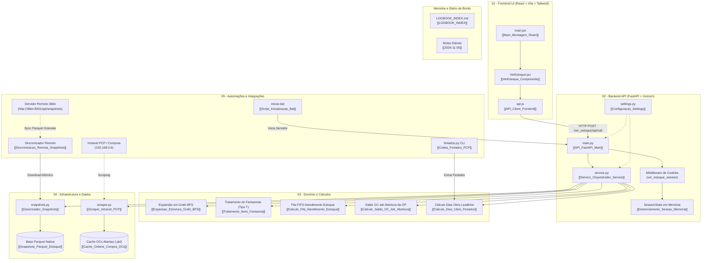

# Visão Geral: Ver_estoque

**Resumo:** Sistema autônomo para análise de estoque, atendimento cumulativo de pedidos em carteira via fila FIFO (Situação L), expansão hierárquica BFS de estruturas de engenharia com tratamento de nós fantasma, enriquecimento gerencial com OPs e Ordens de Compra da Intranet e simulação interativa isolada por sessão de usuário.

## Arquitetura e Fluxo

---

## Índice de Módulos

### 01 - Frontend (Interface de Usuário)
* [[01-Frontend-UI/Main_Montagem_React|Main_Montagem_React]]: Ponto de montagem React 18, StrictMode e tema visual Tailwind.
* [[01-Frontend-UI/VerEstoque_Componente|VerEstoque_Componente]]: Interface principal, tabela infinita, filtros, simulação de pedidos e modais gerenciais.
* [[01-Frontend-UI/API_Client_Frontend|API_Client_Frontend]]: Camada cliente HTTP para invocação RPC e transporte seguro de sessão.

### 02 - Backend (API e Serviços)
* [[02-Backend-API/API_FastAPI_Main|API_FastAPI_Main]]: Aplicação FastAPI, rotas RPC/REST, middleware de cookies e arquivos estáticos.
* [[02-Backend-API/Servico_Orquestrador_Service|Servico_Orquestrador_Service]]: Orquestrador de cálculos, fila de estoque, enriquecimento com OPs/OCs e resumo de pedidos.
* [[02-Backend-API/Scraper_Intranet_PCP|Scraper_Intranet_PCP]]: Cliente HTTP com autenticação em `/home/login/`, leitor de saldos, estruturas JSON e OCs abertas.
* [[02-Backend-API/Gerenciador_Snapshots|Gerenciador_Snapshots]]: Carga seletiva, desempacotamento Parquet e download streaming de snapshots.
* [[02-Backend-API/Configuracao_Settings|Configuracao_Settings]]: Resolução de diretórios, portas, TTL de sessão e variáveis de ambiente.

### 03 - Domínio e Cálculos
* [[03-Dominio-Calculos/Calculo_Fila_Atendimento_Estoque|Calculo_Fila_Atendimento_Estoque]]: Fila de atendimento cronológica FIFO, abatimento de estoque físico e tolerância de arredondamento.
* [[03-Dominio-Calculos/Expansao_Estrutura_Grafo_BFS|Expansao_Estrutura_Grafo_BFS]]: Busca em largura multinível para cálculo do consumo total de insumos e componentes.
* [[03-Dominio-Calculos/Tratamento_Itens_Fantasma|Tratamento_Itens_Fantasma]]: Detecção de nós virtuais `Tipo = 'T'` e promoção hierárquica automática dos filhos.
* [[03-Dominio-Calculos/Calculo_Saldo_OC_Ate_Abertura|Calculo_Saldo_OC_Ate_Abertura]]: Verificação de entregas de Ordens de Compra antes da data programada de abertura da OP.
* [[03-Dominio-Calculos/Calculo_Dias_Uteis_Feriados|Calculo_Dias_Uteis_Feriados]]: Retroação de prazos de lead time desconsiderando finais de semana e feriados industriais.

### 04 - Infraestrutura e Dados
* [[04-Infra-Dados/Snapshots_Parquet_Estoque|Snapshots_Parquet_Estoque]]: Repositório de dados em `./backend/data/snapshots/` com paridade entre Pickle e Parquet colunar.
* [[04-Infra-Dados/Cache_Ordens_Compra_OCs|Cache_Ordens_Compra_OCs]]: Armazenamento serializado das OCs em aberto com indexação de 4 níveis de prioridade.
* [[04-Infra-Dados/Gerenciamento_Sessao_Memoria|Gerenciamento_Sessao_Memoria]]: Isolamento multiusuário em memória (`SessionState`) com controle de expiração por TTL.

### 05 - Automações
* [[05-Automacoes/Script_Inicializacao_Bat|Script_Inicializacao_Bat]]: Script `iniciar.bat` para detecção de ambientes virtuais e inicialização do servidor Uvicorn.
* [[05-Automacoes/Sincronizacao_Remota_Snapshots|Sincronizacao_Remota_Snapshots]]: Sincronizador automático e sob demanda de snapshots a partir de `http://366n:8001/api/snapshots`.
* [[05-Automacoes/Coleta_Feriados_PCP|Coleta_Feriados_PCP]]: Raspador assíncrono em lote para extração do calendário fabril da Intranet.

### Histórico e Logbook
* [[Ver_estoque-logbook/LOGBOOK_INDEX|LOGBOOK_INDEX]]: Índice cronológico de sessões e histórico operacional do projeto.
* [[Ver_estoque-logbook/2026-11-05|2026-11-05]]: Diário de bordo da sessão corrente (Estruturação completa do Vault e grafo Obsidian).
